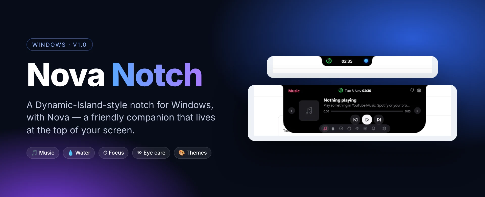
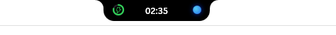
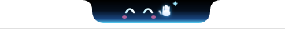
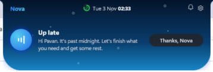
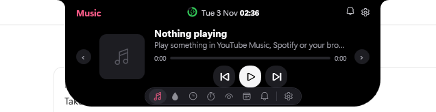
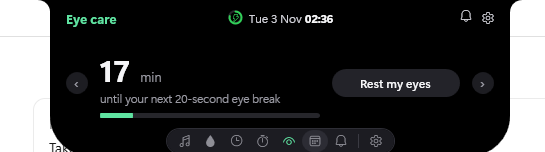
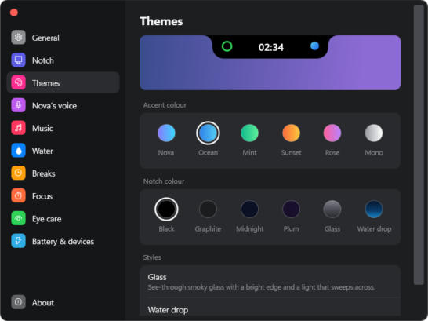

  

  <b>A Dynamic-Island-style notch for Windows, with Nova — a friendly companion that lives at the top of your screen.</b>

  

  
  
  

---

## ✨ What it does

Nova Notch puts a small, always-there notch at the top-centre of your Windows screen. It shows the date and time at a glance, and **expands when you hover over it** into a set of quick panels — so music, reminders and your focus timer are one move of the mouse away, without opening any app.

| | Feature | What you get |
|---|---|---|
| 💬 | **Nova, your companion** | Nova greets you by name and reacts to the time of day — like a gentle nudge to get some rest when you're up past midnight. |
| 🎵 | **Music controls** | See what's playing and play, pause or skip tracks from YouTube Music, Spotify or your browser. |
| 💧 | **Water reminders** | Regular nudges to stay hydrated through the day. |
| ☕ | **Breaks** | Reminders to step away from the screen. |
| ⏱️ | **Focus** | A focus timer right in the notch. |
| 👁️ | **Eye care** | Follows the 20-20-20 rule with a countdown to your next 20-second eye break and a *Rest my eyes* button. |
| 🔔 | **Notifications** | Quick access to recent alerts from the notch. |
| 🔋 | **Battery & devices** | Battery and device status at a glance. |
| 🎨 | **Themes** | 6 accent colours, 6 notch colours and special styles such as smoky *Glass* and *Water drop*. |
| 🗣️ | **Nova's voice** | Choose how Nova speaks to you. |

## 📸 Screenshots

<table>
  <tr>
    <td align="center" width="50%"> <b>Compact</b> — time and status, always visible</td>
    <td align="center" width="50%"> <b>Nova says hi</b> — a playful animated face</td>
  </tr>
  <tr>
    <td align="center"> <b>Companion</b> — time-aware messages from Nova</td>
    <td align="center"> <b>Music</b> — control what's playing</td>
  </tr>
  <tr>
    <td align="center"> <b>Eye care</b> — 20-20-20 eye breaks</td>
    <td align="center"> <b>Settings</b> — themes, colours and styles</td>
  </tr>
</table>

## 📥 Install

1. Download **[NovaNotch-Setup-1.0.1.exe](NovaNotch-Setup-1.0.1.exe?raw=1)**.
2. Run the installer and follow the steps.
3. Nova Notch appears at the top of your screen — hover over it to expand.

> **Windows SmartScreen:** because the installer isn't code-signed yet, Windows may show *"Windows protected your PC"*. Click **More info → Run anyway** to continue.

**Requirements:** Windows 10 or 11 (64-bit).

## 🔒 Source code

The source code for Nova Notch is private. This repository hosts the installer and documentation only.

---

  Built by <a href="https://github.com/PaVaN1063">Pavan Kumar Naraharisetti</a> · <a href="https://pnaraharisetti.netlify.app/">Portfolio</a>

